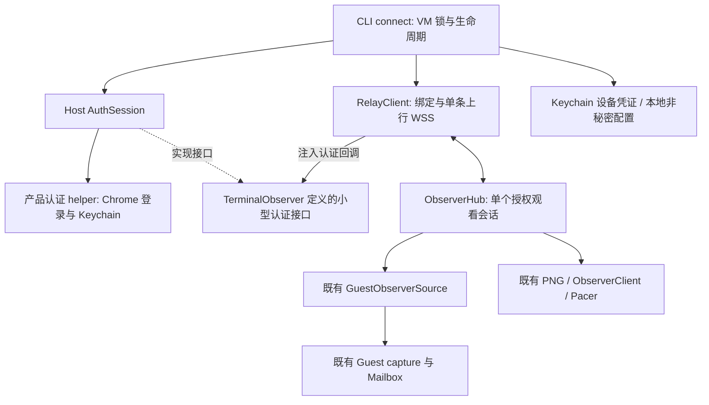

# Remote Observer MVP：terminal-mac 核心改造方案

日期：2026-11-09。状态：本地实现与合成 Swift/Relay/Chrome 闭环已完成，实机验收待执行。本文保留设计基线；当前证据见 [验收记录](REMOTE_OBSERVER_VALIDATION.md) 和 [实机前交付记录](../../specs/REMOTE_OBSERVER_PRELIVE.md)。

2026-11-09 补充：用户已确认原生二维码窗口、到期手动重新生成、确认后自动关窗，以及 connect 成功后前台退出、后台持有唯一连接。生命周期以 [调整说明](REMOTE_OBSERVER_QR_ADJUSTMENTS.md) 为准；只允许精确取消，不允许新 key 自动替换有效 pending。正常恢复保留原 QR/key；网络失败不是取消。

## 1. 结论与已验证边界

核心工作不是重新做截图系统，也不是再次研究 WSS 是否可用，而是把已有观察引擎接到一条经过认证的主动上行连接。

| 能力 | 当前依据 | 本轮动作 |
| --- | --- | --- |
| SSO 后访问入口、带票据 WSS、二进制回显与重连 | 用户已完成 `sso_probe.py` 实测；探针发送 32 KiB 随机数据 | 接受可行性结论；迁移登录能力，只回归变更的路径/客户端，不重做平台调研 |
| Guest 独立采集、PNG full/tiles、累计 dirty、revision/ACK、pacing | 现有 `ObserverSource`、`ObserverHub`、`TerminalMacCore/Observer.swift` 及本地测试 | 复用并回归，不重写算法 |
| Canvas 校验、解码、绘制后 ACK | 现有 `Web/observer.js` 与 JS 测试 | 迁到服务器仓库，修改连接与外层消息适配 |
| connect、扫码绑定、凭证复用、Swift 设备 WSS、观看转发 | 已有本地实现和合成联合测试 | 真实服务/Guest/手机验收仍需执行，不能以合成测试替代 |

验收对象是“本人注册后，通过服务器只读查看 Guest 当前画面”。设备在线不等于 Guest 正常，更不等于任务正在执行或已完成。

配套 [服务器方案](../../specs/REMOTE_OBSERVER_MVP.md) 与 [共享协议 v1](../../specs/REMOTE_OBSERVER_PROTOCOL_V1.md)。共享协议负责字段、超时和消息上限，本文不重复定义。相对链接用于联合工作区；两项目各自独立构建，交付记录固定协议版本和双方 commit。

本文取代 [本地首版决策](PHONE_OBSERVER_DECISIONS.md) 的免绑定本地观看入口。继续复用 [低带宽策略](PHONE_OBSERVER_LOW_BANDWIDTH.md)，[本地验收](PHONE_OBSERVER_VALIDATION.md) 只作为历史，不冒充远端结果。

本轮取代此前“每次启动重新输码、票据只在进程内、退出即注销、离线 30 分钟删除”的决定。服务器仍无数据库；电脑允许在 Keychain 保存设备凭证，以便断网、重启 CLI 后复用绑定。

三个概念严格分开：SSO 确认账号；首次扫码确认设备绑定；日常在服务的设备列表选择已绑定在线设备观看。不能把“二维码只是观看捷径、电脑仅凭 SSO 自动绑定”当成最终方案。

## 2. WSS 验证后仍需开发什么

| 工作 | 最小实现 | 不顺带做 |
| --- | --- | --- |
| A. 认证与绑定接入 | 默认复用 SSO；本地先生成并保存 key；受限 WSS 申请绑定 URL，扫码确认后同连接上线 | 原生登录窗口重写、手机代登录电脑、HTTP 领取/轮询、服务端持久化 |
| B. 主动上行客户端 | 一条 WSS，一个有界有序写者、一个接收循环；心跳、认证 hello、错误分类、普通断线重连 | 公网监听、本地代理服务器、单独管理连接、多路复用 |
| C. Hub 传输适配 | 将对 NIO Channel 的发送/可写性/关闭依赖替换为小接口；传出已有 TMOB Data，传回观察控制 | 重新编码图片、重写 revision、为单观看者重写整个 peers 容器 |
| D. 观看会话生命周期 | open/ready/subscribe/close；旧输出隔离；只在有人观看时采集；观看结束保留设备连接 | 多观看者、抢占、远端选择本地 VM、历史回放 |
| E. 入口与页面迁移 | connect 直接替换 observe；绑定页与设备列表/观看页分离；绑定前不采集；Canvas 移至服务器 | 功能别名、额外的 login/observe 两步启动、新 UI 框架 |
| F. 核心恢复与清理 | ACK 超时、full 恢复、SSO/凭证错误分类；退出断开且保留绑定，显式解绑才撤销 | 自动后台守护、服务器重启无感恢复、图片历史回放 |

完成 B 的“设备在线”不是完成 D/E 的“浏览器能看”；仅发送 full 也不是完整 MVP，必须接通现有 delta 与浏览器 ACK。

## 3. 认证迁移：复用已验证机制

上一版把 `WKWebView` 和“无 Python/Playwright”写成前置门槛，增加了尚未验证的登录链路。这不是 WSS 上行的必要条件，本次移出 MVP 要求。

首版明确沿用已验证的 Chrome/Playwright 登录机制，将相关逻辑迁移为本项目拥有的产品认证 helper，由 Swift `AuthSession` 调用。helper 只负责登录、SSO Keychain 缓存及受保护身份校验；Swift 保存设备凭证并负责 WSS，不由 helper 转发画面。

登录默认启用，不需要 `--login`。有流程冲突时，以 `sso_probe.py` 已验证的用户行为为基线：先无界面复用缓存、必要时做一次受控 SSO 跳转续期、确认失效才打开登录窗、`--force-login` 主动覆盖缓存；不保留固定探针时长、回显阶段或重跑整个测试脚本。认证失败后的自动重登最多一次，网络/TLS/5xx 不据此清缓存。

- 不直接执行、导入或 monkey-patch 根仓库的 `sso_probe.py` / `probe_client.py`；不保留固定 60 秒探针、随机回显、全局 `sys.argv` 改写和探针输出协议。
- helper 使用本程序创建的独立 Chrome 上下文，不读取用户其他浏览器的私有会话库。缓存有效时无界面校验；沿用示例一次受控静默续期，仍失效才人工登录，不承诺永久无感登录。
- SSO Cookie 和设备凭证分别存入本程序 Keychain 条目，彼此不混用。设备条目按规范化服务器 origin、可信账号、本地 observerId 隔离。Cookie 适用域/path/secure/expiry 和重定向边界仍必须正确，不能照搬示例的宽域拼接。
- Swift 与 helper 通过受控匿名管道传递有界结构化结果，含秘密的结果不输出到终端、argv、临时 JSON、日志或服务器诊断。helper 结束后关闭管道与浏览器，不能留一个后台 Python 转发进程。
- helper 交付结果前调用正式受保护 `identity`，不能以开放健康接口 200 证明已登录。若需要身份复核，使用相同受控认证通路。
- 业务请求只向配置服务发送适用 Cookie 和票据；不携带 Bearer 跟随登录重定向。网络/TLS/5xx 不触发清空缓存或新二维码；只有服务端明确 binding_invalid 才重新配对，SSO 失效先登录，同账号的设备凭证保留。
- 首版明确依赖本机 Chrome、Python 3.11+、固定版本的 Playwright/keyring，并提供依赖检查、安装说明和 helper 资源定位。不得运行时静默安装依赖。登录过程中用户交互可取消，失败应有可辨识错误。
- 将来原生化或封装 Python 运行时属于安装体验优化，不阻塞本 MVP，也不宣称当前包已无外部运行依赖。

2026-11-09 排障补充（用户确认）：`connect --verbose` 只启用前台 stderr 诊断，不增加进程或改动绑定/后台生命周期。helper 的可选结构化错误位置沿既有有界结果管道返回，不输出原始异常、Cookie 或设备密钥。显式 verbose 模式允许打印已校验的二维码链接（含短期 scanToken）、pairingId 和有效期，作为默认不打印二维码的排障例外；分享日志前须删去该确认凭据。后台 detach 后不继续打印。

WSS 热路径由 Swift 客户端负责。优先采用 `URLSessionWebSocketTask`，对目标网关的 Cookie/Header、代理/TLS、拒绝跳转、发送完成和大小限制做窄范围适配回归；若不满足再选成熟客户端库，不自行实现 WebSocket。

## 4. 模块边界与关键改动



`AuthSession` 归属 Host 可执行 target，接口定义在 `TerminalObserver` 或由 CLI 注入闭包；`TerminalObserver` 不反向 import `TerminalMac`，不向 Guest 注入登录依赖。新增文件名可按实现组织，不要求一项职责拆一个框架。

| 位置 | 修改边界 |
| --- | --- |
| `CLI.swift` | connect 取代 observe；服务器选择、自动登录、二维码与凭证复用；替换本地 server 启动；保留锁与统一退出清理 |
| 新增 Host 认证适配与 helper 资源 | 完整迁移登录功能；相邻仓库无需存在。没有必要为此修改 `Entry.swift` 增加 WKWebView/AppKit 登录窗口 |
| 新增 `ObserverRelay.swift` | 受限 WSS 的 begin/ready/确认通知、已有凭证恢复、观看消息、心跳与有序发送；无领取轮询，不把断开映射为解绑 |
| 新增少量本地配置与 Keychain 适配 | 在选定 VM 目录单独保存 observerId/上次服务器/设备 ID 等非秘密配置；不修改 Machine 模型，不上传路径；秘密仅在 Keychain |
| `ObserverHub.swift` | 用传输接口替换 `Peer.channel`、`writeAndFlush`、`isWritable`、`channel.close`；只允许 Relay 注册一个活动 peer，无须重写 peers 数据结构 |
| `ObserverSource.swift` | 原采集/租约流程复用；只在现有捕获错误边界映射脱敏错误，不增加无人观看时的 Guest 健康轮询 |
| `ObserverConfiguration.swift` / CLI 默认值 | 启动选用既有 low 配置；既有 standard/low 切换复用，不改变 Guest 显示分辨率 |
| `ObserverServer.swift`、`Web/`、测试和构建资源 | 正式页面迁移到服务端；取消用户本地观察入口；测试 harness 可保留在测试 target；仅移除不再需要的依赖 |

### 4.1 不能仅把 socket 地址改掉

当前 Hub 在 `fail()` 中直接关闭 peer channel；远端模式必须改成结束“观看会话”，不能因关网页或 ACK 超时把“设备连接”一起关掉。只有 WSS 自身不可用、认证失效或设备协议违规才关闭设备连接；整进程退出再停止 Hub。

当前 Hub 的 `started` 在 PNG 编码前赋值。改造时分清编码占槽、发送超时、ACK 超时：编码仍占唯一槽，ACK 计时按共享协议从交给写者开始；本地 send 完成不等于浏览器绘制完成。发送序号先登记，接收循环不能等待发送结束才接 ACK。

现有 Hub 心跳依赖 peer，不能维持无人观看时的设备在线。连接心跳移交 RelayClient，并在电脑侧检测服务器心跳失联；删除远端路径的重复观察心跳。没有观看者时不得通过伪造 subscribe 维持心跳。

### 4.2 单观看者仍要保留的正确性

- 二进制正文不加包装、不解码转码；小控制使用共享协议信封。服务器没有 tile 基准，不能代 ACK。
- 每次 open 清理旧会话，取消旧编码并以 session/generation 阻止迟到回调；有序写者发完或废弃旧输出后发 ready。服务器收到 ready 后通知浏览器，浏览器 subscribe 才触发 capture。
- 原方案多一条 `relay.watch.start`，与上述 ready + subscribe 重复，本次从两端协议删除；保留 ready 屏障，不能把旧图片误投给新观看会话。
- 所有文本/图片共用同一个有序写者，发送有大小和数量上限，不无限创建 Task。读循环独立处理 ACK、心跳和 close。
- 复用一个在途批次、epoch/seq、累计 dirty、pacing、最后变化定时唤醒。ACK 期间的新变化不丢；重连/恢复/改档先 full。
- 拒绝 click/type/action/VM 启停等消息；只读命令不转入通用分发。Guest 失败不采集物理 Host，不代用户启动 VM 或授权。
- 远端隐藏/恢复只使用“关闭观看 WS / 重连并 subscribe”，不再暴露 pause/resume，不保留暂停观看占位；底层已有暂停实现可内部复用。不得因为简化关闭流程而移除 ready 屏障、单槽 ACK 或旧代次隔离。
- 同一物理连接的 connectionId 固定，online 不能退回 binding 或改 deviceId；迟到的 bind.ready 不得重新显示二维码。首个 hello 前仅可收到终止用的 relay.error；握手与业务回调按共享协议状态机检查。

## 5. connect、扫码与恢复

### 5.1 一个命令进入待观看

```sh
terminal-mac connect default
terminal-mac connect default --server https://observer.example.net
```

`default` 是 VM 名；省略名称继续用现有 machineName() 的 default。程序不内置服务器地址，`https://observer.example.net` 仅为占位示例，需替换为实际部署的 HTTPS origin。交互启动且未传 --server 时提示手工输入；已有上次成功认证的地址时回车可复用，否则必须输入。--server 直接配置本次入口，成功认证后按 VM 保存至 `remote-observer.json`；网络重连绝不再次提示输入。

选定入口后复用 SSO，读取该 origin/账号/observerId 下的设备 key。已有 key 用 Bearer 恢复绑定或 pending；首次没有 key 时先本地生成并保存，再只凭 SSO 建受限 WSS。绑定确认前绝不采集，不因建联成功就显示 online。切换服务器不能转移原设备凭证。

`connect` 的后台 worker 保持连接并按需观察；前台仅在当前存活连接的 detach 确认后退出。observe 只给迁移提示，不保留别名；不影响 up/view/action。非交互环境只有入口、SSO、已绑定凭证均可复用才继续；需要登录或首次绑定时退出且保留有效 pending。

### 5.2 电脑出码，网页确认

1. 电脑完成 SSO，用系统随机源生成 32 字节 deviceToken，先写入对应 Keychain 条目；之后建立只允许绑定/心跳的 SSO WSS。此时 state=unbound，没有已绑定设备权限。
2. 同一 WSS 发送 device.bind.begin(observerId, name, deviceToken)。服务器以可信账号创建 5 分钟 pending，立即将 key 转为摘要，只回复 device.bind.ready(pairingId, bindPath, expiresAt)。电脑本地生成指向服务器绑定页的二维码，无需公网入站。
3. 手机扫码进入 `/pair`，以同账号 SSO 登录，核对设备名/短请求标识并点击“确认绑定”；GET/预览不能绑定。服务器原子保存 owner 与设备关系及候选 key 的摘要。
4. 服务器通过原 WSS 推送 relay.hello(state=online, deviceId)。不再通过 HTTP 领取 key，也不等手机返回 key；key 早已在电脑 Keychain。若通知丢失，用这个 key 重连即可恢复同一已确认绑定。
5. 手机显示“绑定成功”，提供“前往我的设备”。用户打开 `/devices`，选择本人已绑定的在线设备后才进入 `/watch/{deviceId}` 并建立观看 WSS；绑定成功本身不开始截图。

二维码只包含短期 scanToken，不能用于设备 WSS 身份认证或长期观看。设备 key 不进入二维码/手机页面，也没有事后“取回 key”的接口。扫码绑定、电脑 SSO 登录以及日常观看是不同操作；同账号 SSO 不能代替要求的首次绑定确认。

扫码是默认绑定交互；终端无法可靠展示二维码时可打开同一绑定确认链接，但仍走相同账号校验和显式确认，不增加自动绑定或手输码协议。

二维码采用系统 CoreImage 的 QR 编码器或成熟库，整数倍显示并保留静区；不手写编码、不调用第三方在线二维码服务。普通终端可显示字符二维码，终端太窄/渲染不可靠时显示同一短期链接，由用户在浏览器打开确认；不再维护另一套手输码绑定流程。短期链接可在交互屏幕展示，但不写入持久日志。

手机浏览器与 WS 能力已确认；仅需针对新绑定页回归 SSO 回跳。页面读 fragment 后清理地址栏，必要时短期放同源 sessionStorage，确认/取消/到期后删除。若网关在 JS 前跳转且丢失 token，可先登录再扫同一有效 QR，不改成免鉴权确认。绑定后日常观看不依赖 fragment、扫码页面或其缓存。

### 5.3 绑定不是在线连接

| 场景 | 行为 | 是否重新扫码 |
| --- | --- | --- |
| 短暂断网、手机关闭/重新打开 | 复用设备凭证；电脑退避重连，新观看会话首先 full | 否 |
| Ctrl+C 后重新 connect、电脑重启后手工启动 | 读取 Keychain；服务端仍保留该绑定则恢复同一 deviceId | 否 |
| SSO 过期 | 按 sso_probe 行为续期或重新登录；同账号设备凭证仍有效则恢复 | 不因 SSO 过期而重新绑定，但身份服务可能要求登录扫码 |
| 服务端重启、绑定被显式撤销、离线超过 7 天被清理 | 旧凭证验证失败，创建新的短期二维码 | 是；全内存服务不承诺跨重启恢复 |
| 更换服务器或账号 | 使用隔离的凭证条目；没有匹配绑定才创建二维码 | 视目标是否已有有效绑定 |
| 绑定确认通知丢失、deviceId 索引未写入 | 用预存 key 重连，服务端返回已确认 deviceId；若仍 pending 则重发原绑定 URL | 有效请求/绑定存在时不用重新确认 |
| 二维码过期、扫码页缓存清空 | 已确认绑定不变，从服务的设备列表直接选在线设备 | 否 |

服务器在线期间保留绑定；下线后保留 7 天，不再 8 小时强制到期或离线 30 分钟删除。正常断开不删绑定，只有网页“解绑”撤销；电脑收到权威失效后清理对应设备条目，不清其他服务器/账号的凭证。SSO 缓存和绑定凭证的期限独立。

Keychain 保存失败时不发 begin、不出二维码，不退回明文文件。确认过程中不生成新 key；服务器只保存摘要。pending 中断后用已保存 key 恢复原请求；服务端不存在记录时才重新发起扫码，不能只用本地 observerId 重建归属。

MVP 不做原地换 key：已有 Device 时新的 begin 被拒绝，key 丢失需先在服务的设备列表解绑，再新扫码；重绑得到新 deviceId。有效或 pending key 未被明确判失效前不能覆盖，不新增双 key/回滚存储。解绑会一并删除二维码对应的 pending/confirmed 票据，旧 key 和旧 QR 都不能恢复授权；SSO 登录本身不恢复设备。

key 已写入但 begin 尚未到达服务器时，重连可能得到规范 binding_invalid。交互模式可进入新的扫码流程，但必须重新确认；网络错误/通用关闭码不能作为删 key 的依据。来自旧连接的失效回调必须比对原 key/连接代次，不能删掉后来建立的新条目。

### 5.4 现有流程的明确改善

- 保留同 VM 的 observer.lock，锁冲突在登录/出二维码之前报出“已有观察连接”；不要为 connect 新加一个可绕过旧锁的进程入口。
- 不调用 `up()` 完成 connect：up 会下载/创建/启动/恢复 VM，并检查 Accessibility；这些超出只读连接。VM 不存在时提示，已存在但停止时可上线等待，观看时返回 vm_stopped，不自动启动。
- 不复用同时要求两项权限的 `GuestReadiness` 作为只读门槛；观察仍只要求 Guest Screen Recording。Entry 的 AppKit 仅服务已批准的原生绑定窗口。
- 配置写在 VM 的独立 remote-observer.json，保留 Machine/machine.json 的现有格式。observerId 为本地随机 ID，不是硬件序列号或身份依据；重命名保留它，克隆为新观察对象时生成新 ID。
- 已交接后 disconnect 仅断开并释放采集、任务和锁，保留绑定；交接前用户 Ctrl+C/关窗仅尝试取消未确认 pending。没有 launchd、自动开机启动或崩溃重启。
- 默认 low，复用已有切档与 hide-cursor；--port 明确报迁移，不保留免绑定本地观看入口。只有设备在线与观看占用可在空闲时宣称，不能虚构 Guest/任务健康。

## 6. 实施顺序与出口

先完成核心闭环，再做恢复和产品清理。P0 是迁移接线，不是重新证明平台支持 WSS；不要求先完成全部发布测试。

| 阶段 | 本次要写的代码 | 本阶段出口 | 不作为前置条件 |
| --- | --- | --- | --- |
| P0 connect 与认证迁移 | 手工配置服务器、observe 移除、产品 helper、Swift 认证适配 | sso_probe 登录行为可复用；手机已验证能力不重做调研，受限 WSS 无图片权限 | WKWebView、纯 Swift 登录、永久无感续登、打包全部依赖 |
| P1 WSS 扫码绑定 | 本地生成并保存 key、受限 WSS begin/ready、手机确认、online 推送、pending/绑定恢复 | 未确认不能上线采集；确认丢消息不丢 key；扫码成功不自动观看；重复/错误确认安全 | HTTP 领取/轮询、PNG 上行、服务端数据库、10 设备压测 |
| P2 独立观看闭环 | 服务设备列表/选择、观看页、Hub transport、TMOB 上行、Canvas/ACK | 从列表选择本人在线设备，无需二维码或 key；真实 full/delta 正确；关观看设备仍在线 | 全套 debug UI、长期内存测试、性能目标调优 |
| P3 核心故障恢复 | 错误分类、完整解绑/重绑、通知丢失、旧会话失效、隐藏关闭/恢复、改档回归 | C01..C07 通过；旧 key/QR 都不能恢复；已有绑定不因普通错误重新出码；不原地替换有效 key | 双 key/回滚、历史录制、后台常驻、账号管理系统 |
| P4 产品清理与交付 | 帮助/依赖说明、资源定位、移除生产本地入口和实验依赖、签名包、独立测试 | C08 和服务端必要联合验收通过；双方版本/限制记录清楚 | 原生登录替换、分发器/多档缓存重构、性能专项 |

P2 必须同步服务端的最小画面适配，不能等“完整 UI 阶段”才接收 ACK。P0/P1 可使用受控合成源测试 transport，但合成通过不代替实际认证和真实 Guest。

## 7. 核心验收

合并重复条目，保留风险边界；既有算法测试继续跑，不为每项重新建立专项项目。

| ID | 必须通过 | 类型 |
| --- | --- | --- |
| C01 | connect 为唯一入口，observe 只提示迁移；服务器/凭证隔离；SSO 行为对齐 sso_probe；错误账号不能继承绑定；up/view/action 不变 | 入口与认证接入 |
| C02 | key 先存 Keychain，失败无 begin/QR；受限 WSS 无图像权限；扫码显式确认、重复确认/消息丢失恢复正确；无轮询/领取；仅 scanToken 不能恢复设备；确认前无在线设备权限 | 首次扫码绑定 |
| C03 | 手机从 `/devices` 选择本人在线设备，不读取 QR/扫码缓存/设备 key；电脑仍需合法凭证；绑定成功不自动采集；full/delta 绘制后 ACK，单槽有界，不 ACK 只结束观看 | 独立观看 + 传输 |
| C04 | viewer.ready 先于观察消息；快速重开、旧编码/ACK无跨会话图片；重复ready不重置授权期限；同连接online不退回binding；新会话full，损坏PNG不ACK | 会话顺序 + 图片回归 |
| C05 | 关闭/隐藏观看释放流，设备仍在线；收到 close 后 <= 15 秒停采集，浏览器冻结且设备链路健康时 <= 60 秒兜底；各阶段取消可回收锁/租约/任务 | 生命周期集成 |
| C06 | 良好网络中15秒断网恢复目标<=60秒且同deviceId；退出/跨夜/同账号重登不扫码；解绑后旧key和QR均失败，重绑新deviceId；旧错误回调不删新key；TLS/DNS/5xx不重配对 | 恢复与完整撤销 |
| C07 | 既有 dirty/revision/PNG/pacing 单测通过；480/640 改档与 viewer 并行无回归；仅 Screen Recording 即可观察，非法控制拒绝且不截 Host | 既有能力回归 + 只读边界 |
| C08 | 电脑与服务器独立构建；helper 和依赖定位明确；产品无免绑定观察入口；Host/Guest 签名验证；真实目标浏览器完成核心联合验收 | 产品收尾 |

MVP 不以 10 设备持续压测、首帧 p95/CPU/RSS 精确门槛、30 分钟长期运行或全平台手机矩阵为前置。连接容量限制、两设备隔离、单会话超时与有界内存仍必须验证；容量/性能专项不是通过删除保护来省略。

## 8. 不做与交付说明

- 不修改 Guest 截图协议或重写采集、PNG、Canvas 算法；不引入 JPEG/WebRTC、任务状态解析、文件和远程控制。
- 允许客户端凭证持久化，但不实现服务器持久化、永久注册、无极/数据库、守护进程、无人值守首次登录、双 WSS、多观看者/抢占或新的多 VM 管理功能。
- 不增加独立 Guest 健康轮询/状态监控系统；不为改 transport 重写 Hub peers、现有低带宽策略或整套测试框架。
- 不把移植到原生登录、内嵌 Python 运行时和无外部依赖安装包作为本轮必须完成的动作。只记录实际依赖，不声称已原生化。
- 测试中保留必要的本机假 transport，不作为产品功能，不提供可绕过绑定的发行入口。JS 解码器移到服务器后只维护一份。
- 验收记录用 `docs/REMOTE_OBSERVER_VALIDATION.md`，记录 C01..C08 与联合项的 pass/fail/blocked、双方 commit、协议版本、实际环境和证据；此轮只写方案，不预填通过。
- 发布构建仍遵守仓库 `AGENTS.md`，不能以 MVP 为理由退回 ad-hoc 或改变 Guest 权限身份：

```sh
CONFIGURATION=release SIGN_IDENTITY=2AECB8B345BA4B952EA6D595AAD94CCE4707A35C bash scripts/build.sh
```
