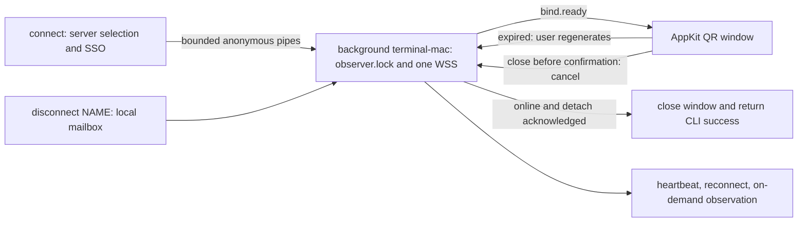

# Remote Observer: QR and Background Connection Adjustment

Date: 2026-11-09. Exact cancellation only; no automatic pending replacement.
Shared protocol v1 section 2.1.2 is normative. Server and native worker changes
are implemented and locally tested; this document is synchronized in both
repositories. Real Keychain/With/mobile verification remains pending.

## Client Flow

- Only initial/manual connect may open UI. Existing bound credentials need no QR.
- QR uses local CoreImage, integer scaling, white quiet zone, fixed image area.
  Five-minute expiry is server-defined; expired QR is greyed under an overlay
  with a central regenerate button. No scanned or success-confirmation screen.
- Confirmed online automatically closes the window; the frontend exits only
  after the background owner acknowledges detach on its still-live connection.
- Window close/Ctrl+C before handoff cancels an unconfirmed attempt. A confirmed
  Device is never revoked by cancellation. Network loss is not explicit cancel.
- Background owns the existing per-VM observer.lock from before login and the
  only device WSS from inception; no socket handover/second WSS. Repeated connect
  reuses a matching online origin/account worker; other active scopes conflict.
- disconnect stops that worker, not the VM or binding. No launch-at-login,
  crash restart, unattended new pairing or interactive background login.

## Upstream Contract Adjustment

1. Pending uniqueness remains `(trusted owner, observerId)`, never observerId
   alone. Same key/name/observerId begin is idempotent; different keys conflict.
   Do not automatically replace pending or Device from a new SSO-only begin.
   A user holding the existing candidate explicitly cancels before a new begin;
   key loss waits for pending expiry. Confirm winning the race keeps its Device.
2. `POST /api/observer/pairings/cancel`: native SSO + Bearer(candidate
   deviceToken), JSON `{observerId,pairingId}`, same-origin/no redirect. Verify
   owner, candidate digest and exact current request. Return
   `{state:"cancelled",pairingId}` after atomic invalidation; if confirmation
   already won, return `{state:"confirmed",pairingId,deviceId}` without revoking.
   Only actually unknown/revoked/expired authorization is 410 binding_invalid.
   Valid key plus wrong observerId/pairingId is 400 invalid_request, preserving
   key and records. Device retains only nonsecret sourcePairingId so that exact
   confirmed cancellation still works after QR cleanup. Requests are <=8 KiB
   strict UTF-8 JSON; cancel <=10/user/minute. Optional Origin is checked exactly.
   Pending sockets close with 4001 only after atomic invalidation. Never log headers.
   There is no cancelled tombstone: after lost cancelled response, retry is 410.
3. Regenerate first checks saved key through device-session. Bound means recover
   online (confirmation notification may have been lost), not new QR. Binding
   means cancel that exact pending before saving a new key. Only authoritative
   cancelled/invalid permits discarding it; network/5xx/unknown response preserves
   the old key. Then use existing unbound WSS begin/ready, not polling/claim.
4. Manual close cancels pending immediately when reachable. Forced kill/offline
   cannot guarantee delivery; saved candidate permits exact cancel/recovery,
   otherwise five-minute TTL bounds abandoned pending. No SSO-only takeover. Browser
   inspect/confirm rejects invalidated old scanToken. Old socket cleanup cannot
   remove the replacement. Existing Device disconnect retention is unchanged.

Local tests cover cancel vs confirm; repeated/stale cancel; wrong-owner refusal;
different-key replacement refusal; old QR rejection; no Device overwrite; expired-window
regenerate; lost-confirmation recovery; frontend death before/after detach;
duplicate worker/lock and disconnect cleanup. Shared protocol v1 includes the
exact cancellation fields/response. Real QR roundtrip remains a joint gate.

## Implemented Audit Corrections

- Detach must validate the current live connection generation, not only stale
  state="online"/cached deviceId. Invalidate online as soon as socket closes,
  before async diagnostics. Acknowledgement proves the handoff commit, not
  everlasting connectivity. Repeat-connect status uses the same current facts.
- Distinguish explicit close/cancel/abandon from network/5xx/auth diagnosis
  failure. General failure cleanup must not automatically cancel a valid pending.
- Native cancellation success requires exact JSON MIME, exact request ID/schema,
  bounded body and preservation on unknown/network responses.
- Keep normal pending resume available without key replacement. Intentional
  regenerate uses diagnose -> exact cancel -> save candidate -> begin. The UI
  must not imply successful cancellation before a server acknowledgement.
- These corrections have native regression tests. P2 Hub/image barrier work is
  also implemented, but neither local tests nor QR fixes certify real SSO/Guest
  acceptance. See the shared pre-live delivery record for evidence and limits.
